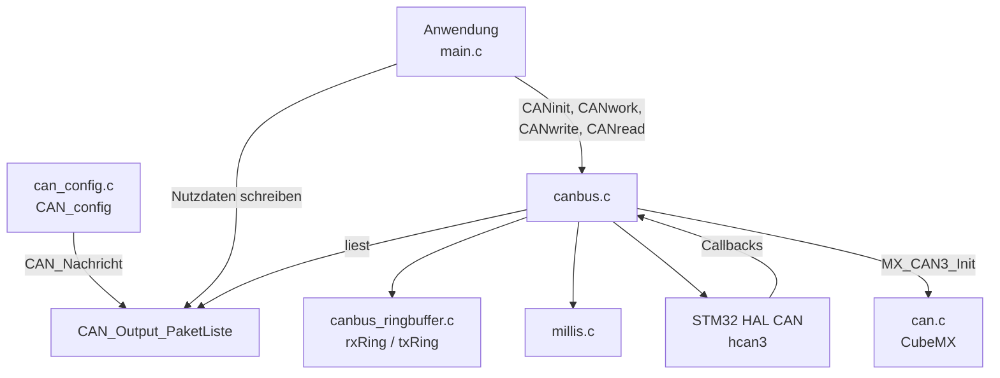
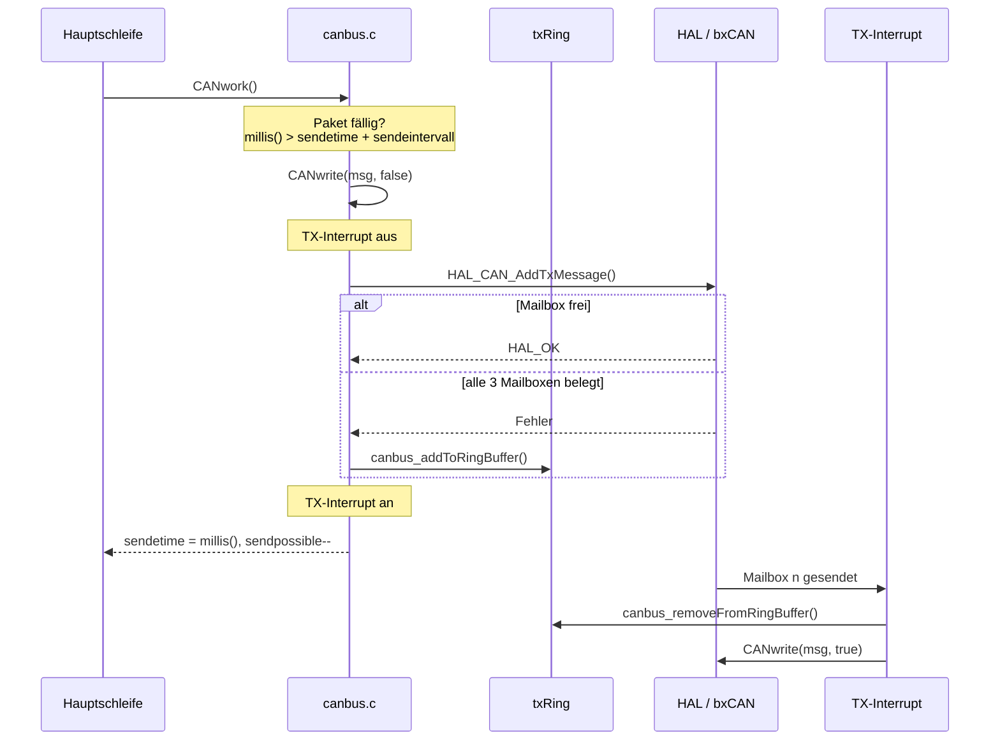
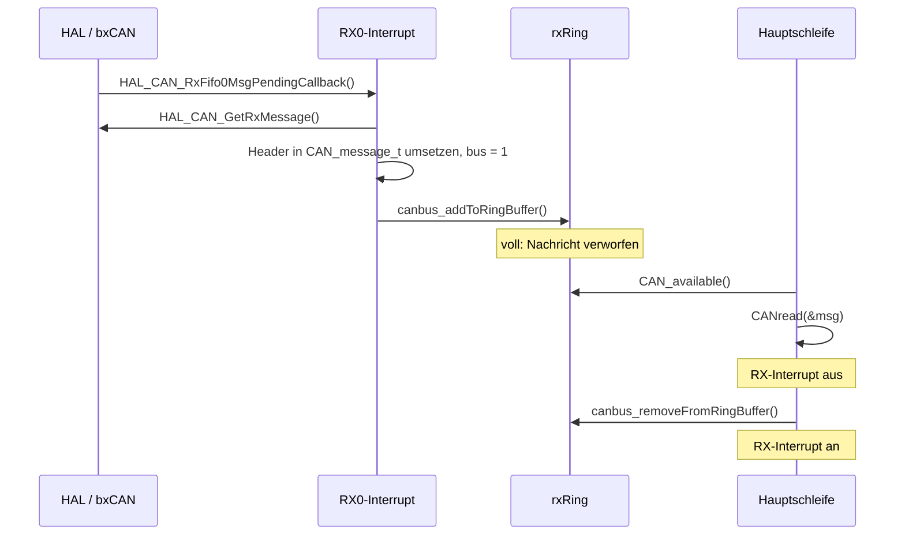

# Architektur STM32 CAN-Bus

Die Bibliothek entkoppelt die Anwendung über zwei Ringpuffer von den bxCAN-Mailboxen
des STM32. Empfangen wird ausschließlich im Interrupt, gesendet direkt aus der
Hauptschleife oder, wenn alle Mailboxen belegt sind, verzögert aus dem Sende-Interrupt.
Darüber liegt die Paketliste, die zyklische Nachrichten zeitgesteuert versendet.

## Komponenten

| Modul | Datei(en) | Aufgabe |
|-------|-----------|---------|
| CAN-Kern | `canbus.c`, `canbus.h` | API, Datentypen, Puffer anlegen, HAL-Callbacks und IRQ-Handler für CAN3 |
| Paketliste | `CAN_Output_PaketListe` in `canbus.c` | Zyklische Sendepakete mit Intervall, Startversatz und Sendeanzahl; `CANwork()` arbeitet sie ab |
| Ringpuffer | `canbus_ringbuffer.c`, `canbus_ringbuffer.h` | FIFO für `CAN_message_t`, je eine Instanz für Senden und Empfangen |
| Paketkonfiguration | `can_config.c` (aus `examples/can_config.c.template`) | Befüllt die Paketliste im eigenen Projekt, überschreibt das `__weak` `CAN_config()` |
| Peripherie | `can.c` (CubeMX), STM32 HAL | Bitrate, Filter, Start des Busses, Empfangsinterrupt |
| Zeitbasis | `millis.h` ([STM32_Millis](https://github.com/Diveturtle93/STM32_Millis)) | Millisekundenzähler für die Sendeintervalle |

`canbus_ringbuffer.h` bindet `canbus.h` für den Typ `CAN_message_t` ein. Der Ringpuffer
kennt weder HAL noch Interrupts, die Sperren übernimmt der CAN-Kern.

## Datenfluss

### Senden

`CANwork()` aktualisiert `sendetime` und `sendpossible` nur, wenn `CANwrite()` die
Nachricht gesendet oder gepuffert hat. Ist auch der Sendepuffer voll, wird das Paket beim
nächsten Aufruf von `CANwork()` erneut versucht. Aus dem Interrupt ruft die Bibliothek
`CANwrite()` mit `true` auf, damit eine Nachricht aus dem Sendepuffer nicht wieder in ihn
zurückgeschrieben wird.

### Empfangen

## Speicher und Ressourcen

| Ressource | Belegung |
|-----------|----------|
| Heap | Sende- und Empfangspuffer, einmalig per `malloc` in `CANinit()`, nie freigegeben. Größe `N × sizeof(CAN_message_t)`, nutzbar sind `N − 1` Einträge |
| RAM statisch | `CAN_Output_PaketListe[ANZAHL_OUTPUT_PAKETE]`, zwei `RingbufferCANBusTypeDef` |
| Peripherie | CAN3 (`hcan3`), RX-FIFO 0, alle drei TX-Mailboxen |
| Interrupts | `CAN3_TX_IRQn`, `CAN3_RX0_IRQn`; die Handler liegen in `canbus.c`, nicht in `stm32xxxx_it.c` |

Der Heap muss im Linker-Skript groß genug für beide Puffer sein. `malloc` wird nicht auf
`NULL` geprüft.

## Nebenläufigkeit

Jeder Ringpuffer hat genau einen Schreiber und einen Leser. Beide Seiten ändern nur ihren
eigenen Index (`head` bzw. `tail`), daher reicht es, den Interrupt der Gegenseite während
des Zugriffs abzuschalten.

| Puffer | Schreiber | Leser | Schutz |
|--------|-----------|-------|--------|
| `rxRing` | RX0-Interrupt | Hauptschleife (`CANread()`) | `CANread()` schaltet `CAN_IT_RX_FIFO0_MSG_PENDING` ab |
| `txRing` | Hauptschleife (`CANwrite(…, false)`) | TX-Interrupt | `CANwrite()` schaltet `CAN_IT_TX_MAILBOX_EMPTY` ab |
| `CAN_Output_PaketListe` | Anwendung, `CANwork()` | `CANwork()` | keiner, nur aus der Hauptschleife verwenden |

`CAN_available()` liest `head` und `tail` ohne Sperre. Das ist zulässig, weil beide
`volatile uint16_t` sind und atomar gelesen werden; der Wert kann nur zu klein sein.

`CANwrite()` und `CANread()` dürfen nicht aus einem anderen Interrupt aufgerufen werden.
Die Bibliothek ist nicht für ein RTOS mit mehreren Tasks ausgelegt.

## Erweiterung

### Neues zyklisches CAN-Paket

1. `ANZAHL_OUTPUT_PAKETE` in `main.h` erhöhen.
2. In `CAN_config()` einen Eintrag mit `CAN_Nachricht()` anlegen und `msg.flags` setzen.
3. Nutzdaten in der Anwendung über `CAN_Output_PaketListe[i].msg.buf[]` aktualisieren.

### Weiterer CAN-Bus (CAN1, CAN2)

Die Stellen sind im Code mit `TODO` markiert. Nötig sind:

- je Bus ein eigenes Paar `rxRing` / `txRing` und eine Zuordnung `CanHandler->Instance` → Puffer,
- in den HAL-Callbacks eine Fallunterscheidung je Instanz und ein eigener Wert für `msg.bus`,
- eigene IRQ-Handler je Bus,
- in `CANwrite()` die Auswahl des Handles über `msg.bus` statt des festen `hcan3`.
